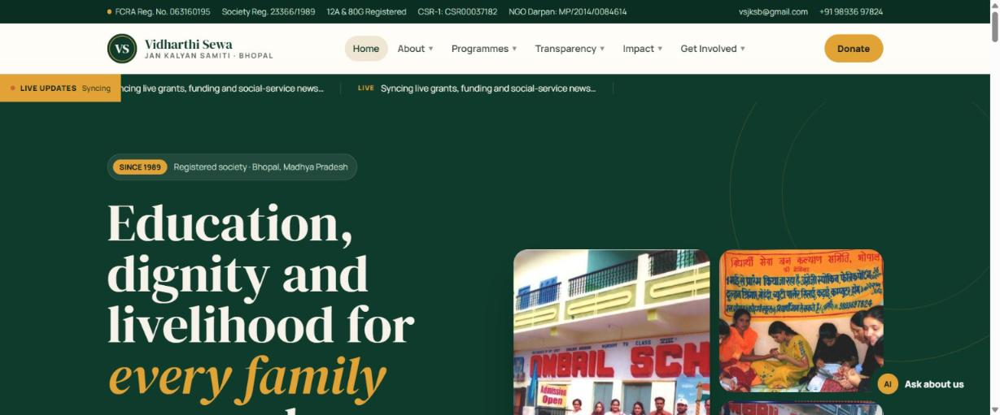
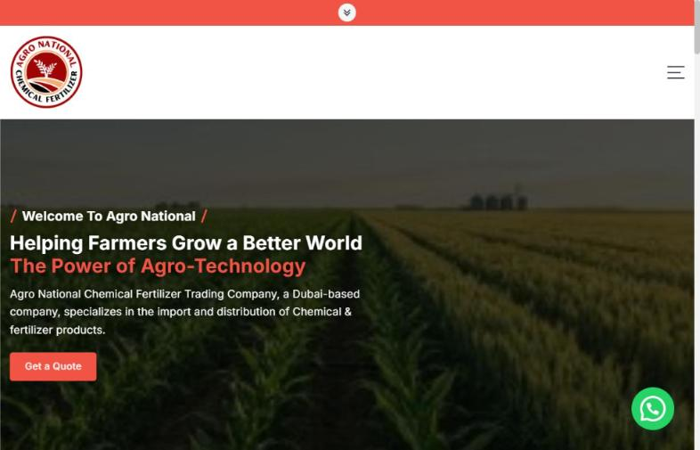
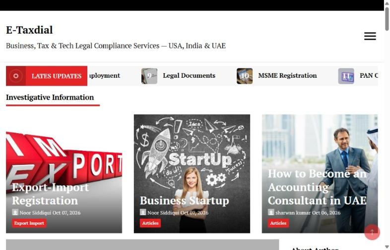
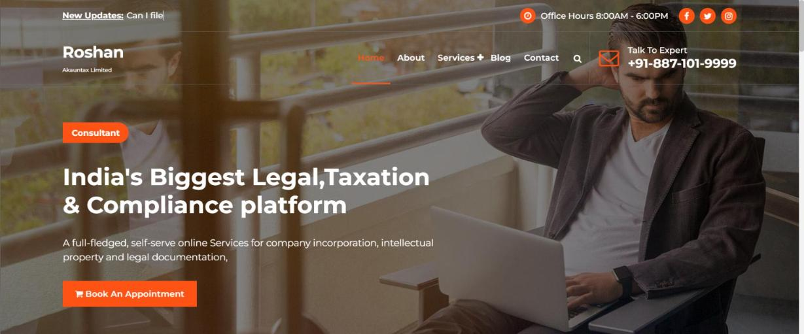
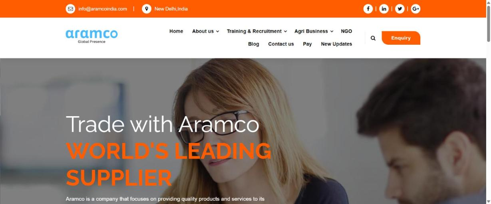

# Projects

Live websites and products I've built and run for my own ventures. Most of the code is private because it runs real businesses; this page shows the work itself. Every site below is live, and each screenshot was taken from the live site in October 2026.

Since January 2021 I've managed hosting for these sites myself through a WHM/cPanel account. Newer products, such as [IZN AI](https://github.com/NoorSiddiquiDubai/izn-ai) and the Agro National trade CRM, run on separate Linux servers with their own deploy pipelines.

---

## Vidharthi Sewa Jan Kalyan Samiti — [vsjksb.world](https://vsjksb.world)

Website for an FCRA-registered NGO in Bhopal that has run schools, skills training and welfare programmes since 1989.

- Custom JavaScript front end, not a page builder
- Registration and compliance numbers up front (FCRA, 12A/80G, CSR-1, NGO Darpan), plus transparency pages, so donors and CSR teams can check the organisation before they give
- Programmes, impact and "get involved" sections, a donate flow, a live updates strip and an "Ask about us" assistant

## Agro National — [agronational.ae](https://agronational.ae)

Dubai-based B2B trader of fertilizers and agri-chemicals (DAP, Urea, MOP and more) for buyers across the Middle East and Africa.

- WordPress, Elementor and WooCommerce: product catalogue and a "Get a Quote" flow
- WhatsApp contact and Google Site Kit analytics
- Behind the website: a private trade CRM that brings email, web-form and WhatsApp leads into one queue, with AI-drafted replies that a person approves before anything is sent

## eTaxDial — [etaxdial.com](https://etaxdial.com)

Business, tax and legal-compliance guides for India, the UAE and the US: company registration, GST and VAT, MSME, PAN, trademarks, export-import registration.

- WordPress publication with categories, a live-updates ticker and author pages
- I write many of the articles myself

## Roshan — [roshantax.com](https://roshantax.com)

Self-serve legal, tax and compliance services for Indian companies: incorporation, income-tax filing, GST, trademarks and accounting.

- WordPress and Elementor, service pages, appointment booking and an expert call line

## Tripvizer — [tripvizer.com](https://tripvizer.com)

Tour-package site for trips to Nepal, Sri Lanka, Bhutan and the Maldives.

- WordPress with a travel-booking plugin: trip search by activity, budget, destination and duration
- Customer login and sign-up, destination and tour-type pages, blog

## Aramco India — [aramcoindia.com](https://aramcoindia.com)

Corporate site for my New Delhi trade company: commodity sourcing (agri products and fertilizers), training and recruitment, and an online payment page.

- WordPress and Elementor, enquiry flow, blog and updates

---

## Work with me

I build websites, CRMs and AI automation for trading companies and other B2B businesses, and I run them in production. Reach me on [LinkedIn](https://www.linkedin.com/in/nooruddinsiddiqui).
